# ResolvAI: Business Entity Resolution at Scale


ResolvAI matches **10 million noisy business records** from two independent data sources to **1.7 million reference
businesses** across the US, India and France, using only business names and addresses.
A group project by team **ByteForce** (Ajeet Kumar, Anu Priya).

**Result:** **F0.5 = 0.951** on a hidden test set (macro, precision-weighted), up from 0.641 for a similarity baseline.
Held-out validation score 0.970.

---

## The problem

For every reference business, find all records in the other two sources that describe the same real-world business.
There are no shared IDs, the data is heavily noisy, and the metric (**F0.5**, averaged per entity) punishes a wrong merge
about twice as much as a missed match.

| Reference record | Noisy records of the same business |
|---|---|
| Fortune Finance Private Limited, F.No.202, Aranaya Balbharda East B.C.Road, Patna | `fortunefinance.com` · `फॉर्च्यून फाइनेंस प्राइवेट लिमिटेड` |
| Dorelle's Ace Cargo LP, 4009 47th Street, Kansas City, MO | `DAC` · `Dorelle's Ace Cargo (LLC)`, 4009 47th Street, Missouri |
| Prairie Islands, 930 Park Central Drive, Unit C, Indianapolis | `Prairie Islands Islands`, `00930 PARK CENTRAL DRIVE` |

The hard part is **look-alikes**: the same name at a different address (chains, `826` vs `828 William St`) and different
businesses at the same address. 13.5% of Indian records use native scripts (Hindi, Bengali, Kannada, Malayalam), and the
test set contains **France**, a country that never appears in training.

## Architecture

```mermaid
flowchart LR
    A[Raw TSVs<br/>12.5M train / 11.7M test records] --> B[Normalisation<br/>transliteration, legal forms,<br/>state/city aliases, house numbers]
    B --> C[Blocking<br/>3 TF-IDF channels per country<br/>top-30 sparse cosine each]
    C -->|130M candidate pairs<br/>98.8% recall| D[LightGBM stage 1<br/>45+ pair features]
    D --> E[LightGBM stage 2<br/>competition + sibling-agreement<br/>context features]
    E --> F[Multilingual cross-encoder<br/>MiniLM-L12, fine-tuned on 2.5M hard pairs]
    E --> G
    F --> G[LightGBM stacker<br/>+ cross-encoder context]
    G --> H[Global one-to-one assignment<br/>+ F0.5-tuned threshold]
    H --> I[matching_results.tsv]
```



1. **Blocking.** Per country (an open set, so the unseen country needs no special handling), three complementary TF-IDF
   channels: name character 3-grams, address word tokens and name+address 4-grams. The union keeps **98.8% of true pairs**
   (ceiling F0.5 0.996) with about 75 candidates per entity. Pruning frequent n-grams made the sparse search **6× faster**
   at under 0.2% recall cost.
2. **Pair matcher.** A two-stage LightGBM. Stage 1 uses fuzzy name/address similarities, transliteration-robust consonant
   skeletons (`praaivett limittedd` → `prvt lmtd`), acronyms, and house-number equality or near-miss (`6421` vs `6424`).
   Stage 2 adds **competition** features (how a pair ranks against the entity's other candidates and against rival
   entities claiming the same record) and **sibling agreement** (does this record agree with the entity's other strong
   records?).
3. **Cross-encoder.** `paraphrase-multilingual-MiniLM-L12-v2` (Apache-2.0, 118M parameters), fine-tuned as a binary pair
   classifier in fp16 and scored across two T4 GPUs. It reads both records side by side, which handles native scripts and
   subtle look-alikes.
4. **Stacker and decision.** A LightGBM stacker combines LightGBM probabilities, cross-encoder scores and their
   competition context. It is trained only on entities the cross-encoder never saw. Each noisy record is then assigned to
   at most one reference entity (one-to-one), and the threshold is tuned for F0.5 on held-out entities.

## Results

Held-out training entities, evaluated at **full test density**:

| Stage | F0.5 | Gain |
|---|---|---|
| TF-IDF similarity rule | 0.718 | |
| LightGBM stage 1 | 0.932 | +0.214 |
| + stage-2 competition context | 0.937 | +0.005 |
| + sibling-agreement features | 0.943 | +0.006 |
| + multilingual cross-encoder (blend) | 0.967 | **+0.024** |
| + learned stacker | **0.970** | +0.003 |

Hidden test set: 0.641 → 0.917 → 0.948 → **0.951**.

## Engineering lessons

- **Sampling hides the hard cases.** A 10% development sample scored 0.92 with a simple rule; the same rule scored
  **0.72** at full scale, because sampling removes most look-alikes. All later tuning used full-density held-out
  entities, and held-out scores then tracked the test set within about 0.02.
- **A silent data bug.** Business names containing `"` made the default CSV parser merge thousands of rows. Reading with
  `quoting=QUOTE_NONE` fixed it; three sanity checks (ID coverage, row counts, empty countries) caught it.
- **Memory engineering on 30 GB machines.** 130M-pair feature matrices are built in chunks into compact float32 arrays,
  inference runs country by country (pairs never cross countries, so the results are identical with about half the
  peak memory), and output self-checks stream line by line instead of loading 1.7 GB files.
- **Constrained compute.** Everything ran on free-tier cloud notebooks (4 CPUs, 30 GB RAM, 2× T4), with long jobs run in
  the background and saving resumable checkpoints.

## Repository structure

```
src/
  baseline_pipeline.py   loading, normalisation, per-country TF-IDF blocking, cosine scoring
  route_b.py             feature engineering, two-stage LightGBM, one-to-one assignment, threshold tuning
  ce.py                  multilingual cross-encoder fine-tuning and batched fp16 scoring
  stack.py               out-of-sample cross-encoder scores, stacker, decision-rule selection, final outputs
  merge_ce.py            averaging several cross-encoders (ensemble)
tests/
  make_synthetic.py      synthetic data in the pipeline's input format
  run_smoke.sh           end-to-end run on synthetic data (CPU, about 75 s)
docs/
  METHODOLOGY.md         detailed methodology and error analysis
```

## Run it

Quick check on synthetic data (no real data or GPU needed):

```bash
pip install numpy pandas pyarrow scipy scikit-learn sparse_dot_topn==1.2.0 rapidfuzz unidecode lightgbm psutil
bash tests/run_smoke.sh
```

Full pipeline (put the seven input TSVs anywhere under `<root>`; scripts find files by name):

| Step | Command | Hardware |
|---|---|---|
| 1 | `python src/baseline_pipeline.py --data_root <root> --split test` | CPU, ~6 h |
| 2 | `python src/baseline_pipeline.py --data_root <root> --split train --s1_frac 0.5` | CPU, ~6 h |
| 3 | `python src/route_b.py --data_root <root> --mode train` | CPU, ~1.5 h |
| 4 | `python src/route_b.py --data_root <root> --mode test` | CPU, ~1.5 h |
| 5 | `python src/stack.py --data_root <root>` | 2× T4 GPU, ~3.5 h |

Every script ends with a self-check of the output format (one row per entity, no duplicates, valid IDs, matches ⊆
candidates).

The dataset is not included in this repository. No external data, APIs or lookups were used.

## Team

**ByteForce**, IIIT Kottayam: [Ajeet Kumar](https://github.com/ajeetkartikay) and Anu Priya.
