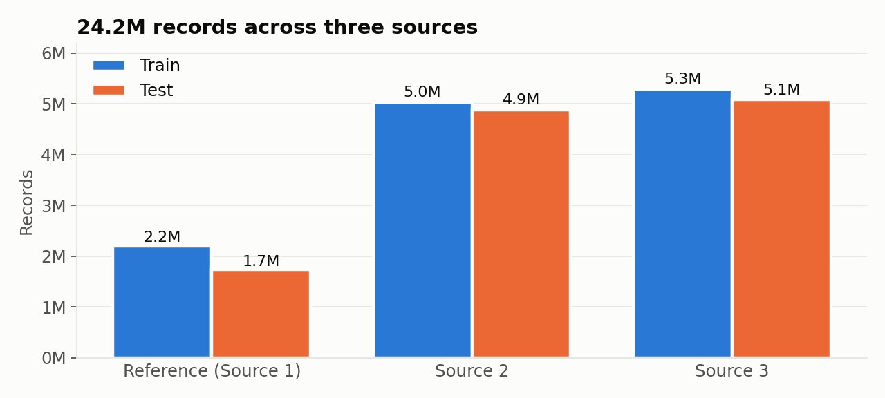
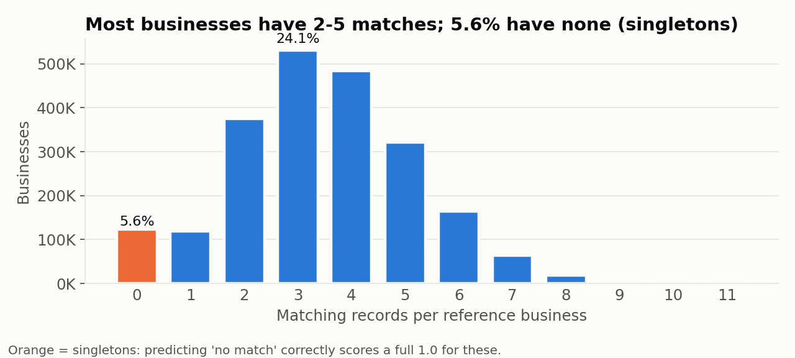
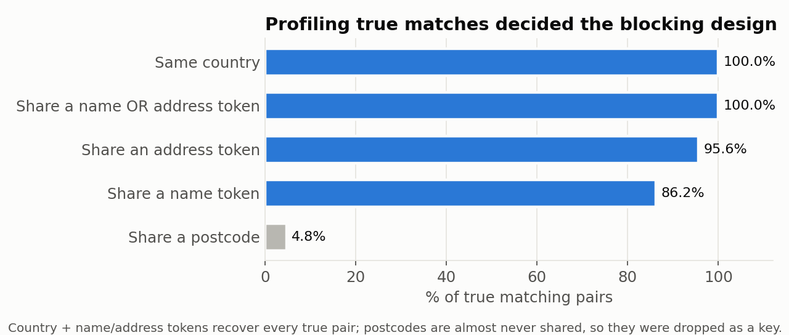
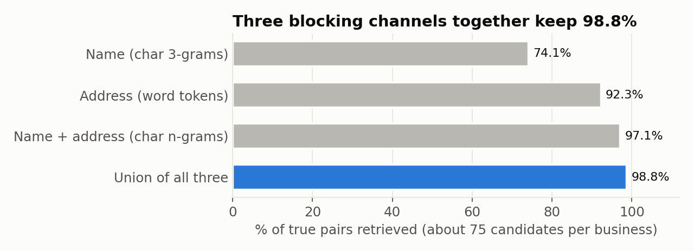
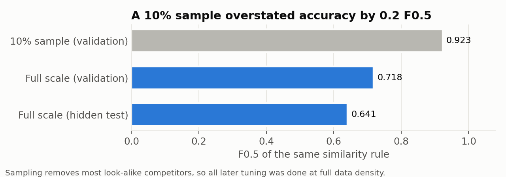
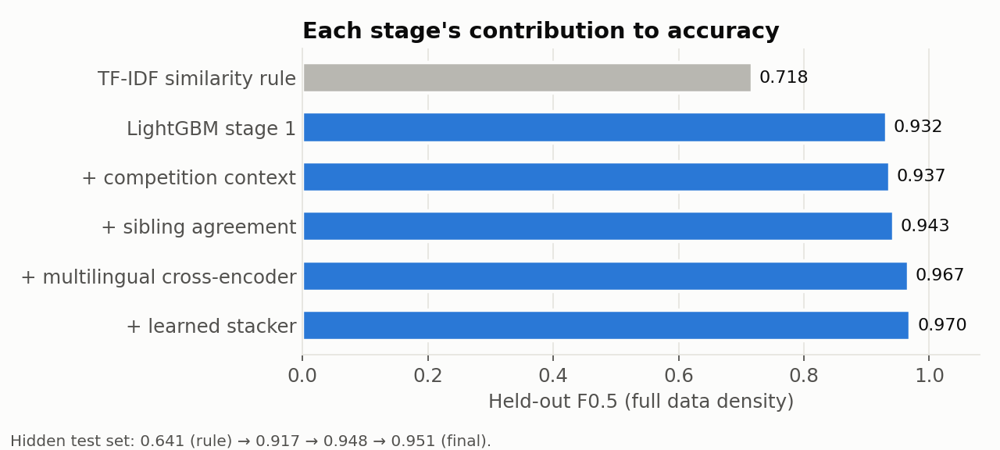
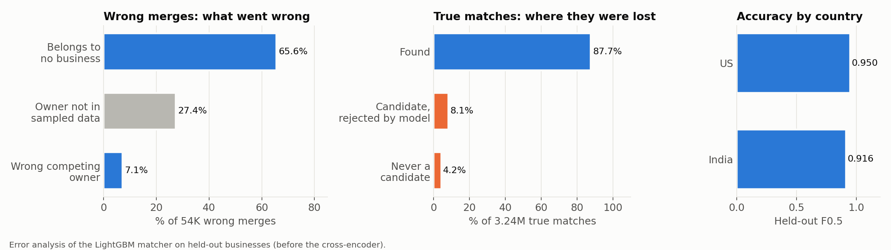

# Data analysis: what the data told us, and what we did about it

This page summarises the analysis behind ResolvAI: profiling 24.2M records, measuring where the pipeline loses accuracy,
and the decisions each finding drove. All figures are regenerated with `python analysis/make_figures.py` (the numbers
were measured during the project, so no dataset is needed).

## 1. The data at a glance

| Source | Train | Test |
|---|---|---|
| Reference (Source 1) | 2,206,821 | 1,732,544 |
| Source 2 | 5,034,616 | 4,887,273 |
| Source 3 | 5,285,603 | 5,082,316 |

- About **27% of Source 2/3 records match no reference business**: pure noise that has to be rejected.
- **13.5%** of Indian records write the business name in a native script (Hindi, Bengali, Kannada, Malayalam);
  **3.8%** have an empty address.
- The test set adds **France** (259,452 reference businesses), a country absent from training.

## 2. How many matches does a business have?

Most businesses have 2–5 matching records, and **5.6% have none**. Because the metric averages per business, correctly
predicting "no match" for those is worth as much as perfectly matching a business with five records. This is why the
pipeline explicitly models "match nothing" instead of always returning the best candidate.

## 3. What do true matches have in common?

Profiling 183K known matching pairs showed that **every** true pair is in the same country and shares at least one name
or address token, while postcodes are shared only 4.8% of the time. **Decision:** search for candidates within each
country using name and address tokens, and don't rely on postcodes.

No single signal is enough (name alone finds 74%), but three complementary channels together keep **98.8%** of true
matches while looking at only about 75 candidates per business instead of millions.

## 4. A sampling trap

A simple similarity rule scored **0.923** on a 10% sample but only **0.718** at full scale, and 0.641 on the hidden
test set. Sampling removed most of the look-alike businesses (same name in another city, different business at the
same address) that make the real task hard. **Decision:** all model selection and threshold tuning was redone at full
data density. After that, validation scores tracked the hidden test set to within about 0.02.

## 5. Where accuracy came from

| Stage | Held-out F0.5 |
|---|---|
| TF-IDF similarity rule | 0.718 |
| LightGBM stage 1 | 0.932 |
| + competition context | 0.937 |
| + sibling agreement | 0.943 |
| + multilingual cross-encoder | 0.967 |
| + learned stacker | 0.970 |

The trained matcher gave the biggest jump; the multilingual cross-encoder was the largest single addition after that.

## 6. Where the remaining errors are

- **Wrong merges:** two thirds are near-identical records that belong to no business at all, e.g.
  `Nexeus Printing, 1521 8th Ave` vs `Nexeas Printing, #1526 Eighth Ave`. **Action:** added "sibling agreement"
  features (does a record agree with the business's other records on house number and spelling?), worth +0.006.
- **Missed matches:** 8.1% of true matches were candidates but rejected (typical cases: native-script names and empty
  addresses), 4.2% were never retrieved. **Action:** added a multilingual transformer that reads both records side by
  side, worth +0.024.
- **By country:** India (0.916) trails the US (0.950), largely because of transliteration and script variety, the main
  reason for adding a multilingual model.

## Key takeaways

1. **Validate at production scale.** Sampled evaluation overstated accuracy by 0.2 F0.5.
2. **Profile before you model.** Simple profiling (country shared 100%, postcode 4.8%) settled the candidate-search
   design.
3. **Break errors down before fixing them.** Each improvement targeted a specific error group found in the breakdown.
